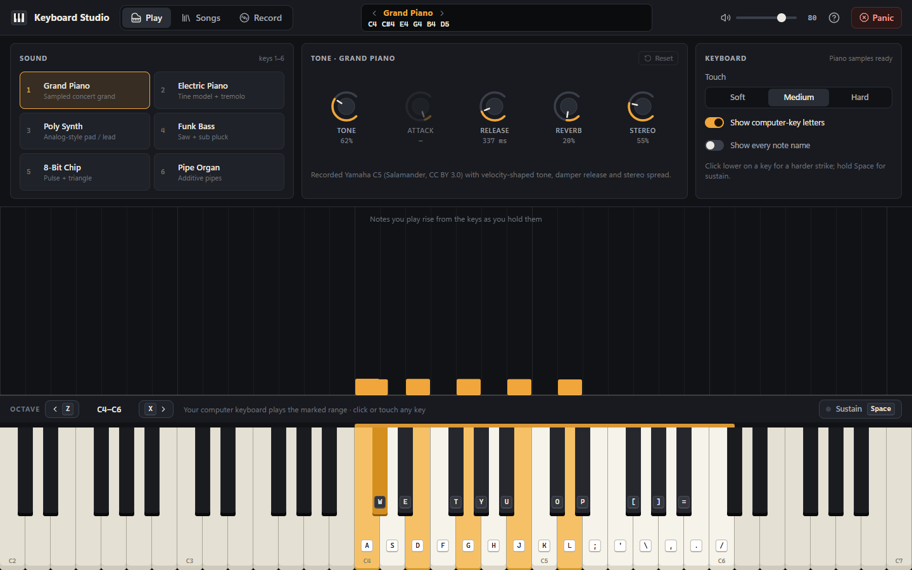
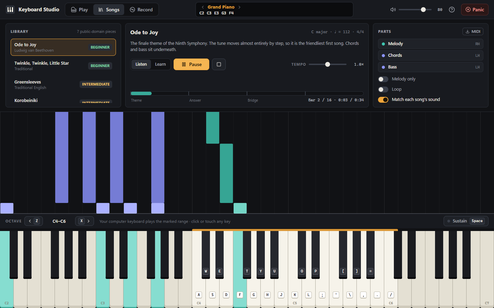
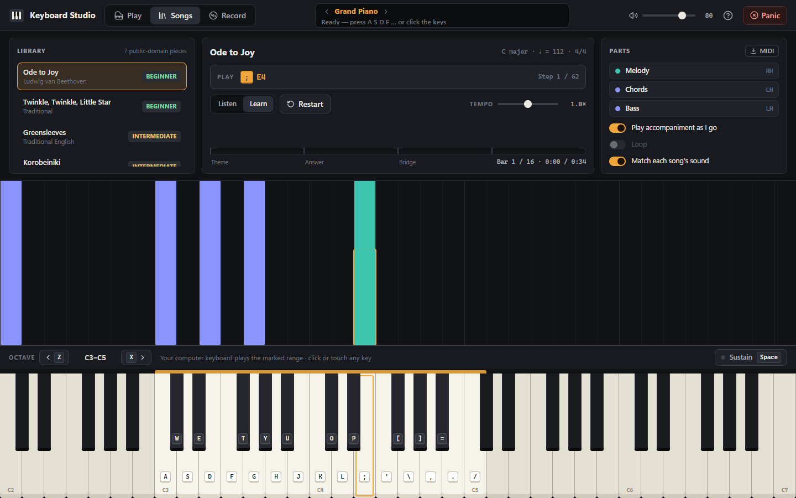

# Keyboard Studio 🎹

Turn your computer keyboard into a piano. A recorded concert grand, a Rhodes-style
electric piano, a polysynth, a funk bass, an 8-bit chip and a pipe organ; seven
fully arranged songs with a falling-note view; a Learn mode that waits for you;
recording with MIDI export. Everything runs in the browser, offline, with no
backend or account.



| Songs (Listen) | Songs (Learn) |
| --- | --- |
|  |  |

## Playing

| Keys | Action |
| --- | --- |
| `A S D F G H J K L ; ' \ , . /` | White keys, two octaves plus the top C |
| `W E T Y U O P [ ] =` | Black keys |
| `Z` / `X`, `↓` / `↑` | Octave down / up (the marked band slides along the 61-key keyboard) |
| `Space` (hold) | Sustain pedal; the **Sustain** button latches it |
| `1` – `6` | Choose a sound |
| `Esc` | Panic: silence everything |
| `?` | Help and shortcuts |

Mouse and touch work too: click lower on a key for a harder strike, drag across
keys for a glissando, use several fingers for chords.

## Features

- **Sounds** – *Grand Piano* is a real recording (Salamander Grand Piano, Yamaha C5) with
  velocity-shaped tone, damper release and stereo spread. *Electric Piano* (tine FM model with
  pickup saturation, tremolo and chorus), *Poly Synth* (unison saws, 24 dB resonant filter that
  opens on every key), *Funk Bass*, *8-Bit Chip* (band-limited pulse + triangle, delayed
  vibrato) and *Pipe Organ* (additive ranks with key chiff) are synthesised live. Five rotary
  controls per sound (tone, attack, release, reverb and a sound-specific character control).
- **Songs** – Ode to Joy, Twinkle Twinkle, Greensleeves, Korobeiniki, Für Elise, Canon in D and
  Bach's Prelude in C. Each is a real multi-part arrangement (melody, chords, bass or two
  hands) so several keys sound and light up at once. Mute any part, listen to the melody only,
  change tempo while it plays, loop, jump by clicking the timeline, or export the arrangement
  as a multi-track MIDI file.
- **Learn mode** – the melody waits for you. The target key is outlined and its computer-key
  letter is shown; the right note name in any octave counts, so beginners never need an
  impossible chord. The accompaniment plays along as you advance.
- **Note roll** – song notes fall onto the keys that will sound; the notes you play rise away
  from the keys.
- **Recorder** – takes keep your touch and sustain pedal, replay with lit keys, can be renamed,
  and export as `.mid` (one track per sound, CC64 pedal events included).
- **Local first** – preferences and takes live in `localStorage`; a service worker caches the
  app and piano samples after the first visit so it works offline.

## Songs

| Song | Parts | Level |
| --- | --- | --- |
| Ode to Joy (Beethoven) | melody · chords · bass | Beginner |
| Twinkle, Twinkle, Little Star | melody · left hand (Alberti bass with ringing root) | Beginner |
| Greensleeves | melody · waltz chords · bass | Intermediate |
| Korobeiniki (folk) | melody · oom-pah chords · walking bass | Intermediate |
| Für Elise (Beethoven) | right hand · left hand (rolling arpeggios) | Intermediate |
| Canon in D (Pachelbel) | melody · harmony · ground bass, five variations | Intermediate |
| Prelude in C (J. S. Bach) | arpeggio · bass | Advanced |

## Development

```bash
npm install
npm run dev          # http://localhost:5173
npm run typecheck
npm test             # Vitest: 130+ unit/integration tests
npm run test:e2e     # Playwright: layout stability, songs, learn, recording, audio render, offline
npm run build        # production build in dist/
npm run probe:audio  # offline-render loudness / clipping / tail report per instrument
npm run screenshots  # regenerate docs/screenshots/after
```

`npm run test:e2e` starts the dev server and a production preview (for the offline test)
automatically. Playwright uses a Chromium found under `%LOCALAPPDATA%\ms-playwright` when
present.

### Layout

```
src/
  music/      pure music: notes, chord naming, song model + notation parser, arrangements
  audio/      Web Audio engine: voices, buses/effects, sample bank, shared assets
  playback/   audio-clock sequence player, Learn session, take conversion
  app/        studio controller (input, transport, recording, persistence)
  state/      tiny external store
  components/ React UI
  data/       key map + geometry, instrument presets
  utils/      MIDI export, storage
public/samples/piano/   Salamander samples + ATTRIBUTION.txt
docs/       REVIEW.md (audit + results), screenshots
```

See [ARCHITECTURE.md](ARCHITECTURE.md) for the design and [docs/REVIEW.md](docs/REVIEW.md) for the
audit of the first version, what changed and how it was verified.

## Credits and licensing

- **Grand piano samples:** *Salamander Grand Piano* by Alexander Holm, licensed
  [CC BY 3.0](https://creativecommons.org/licenses/by/3.0/). Source:
  <https://archive.org/details/SalamanderGrandPianoV3>. See
  [`public/samples/piano/ATTRIBUTION.txt`](public/samples/piano/ATTRIBUTION.txt). Attribution is
  also shown in the in-app help.
- **All other sounds** are synthesised at runtime; no other audio assets are used.
- **Songs** are public-domain compositions; the arrangements in `src/music/songs.ts` are
  original to this project.
- Icons: [lucide](https://lucide.dev) (ISC).
